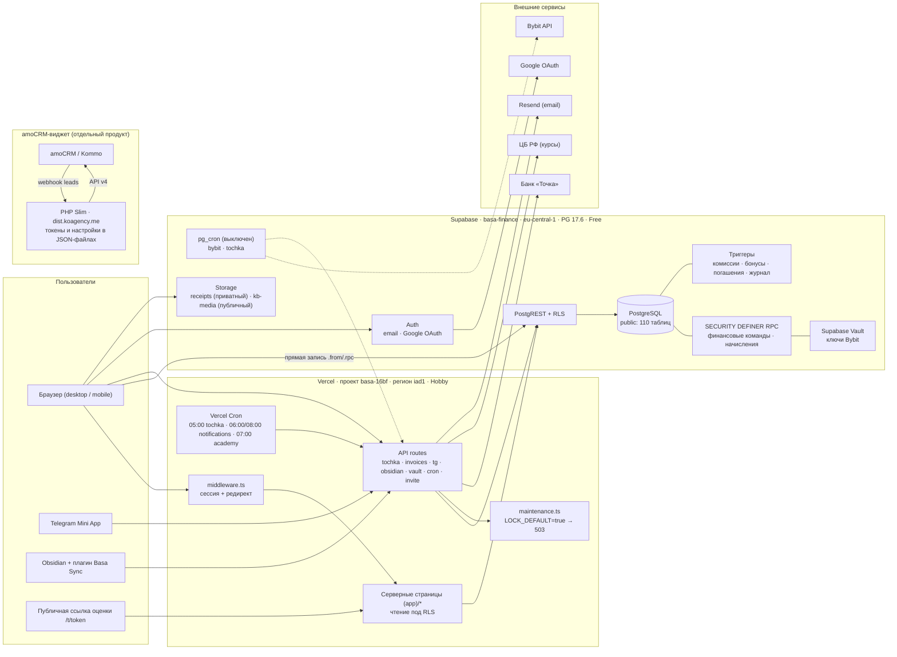
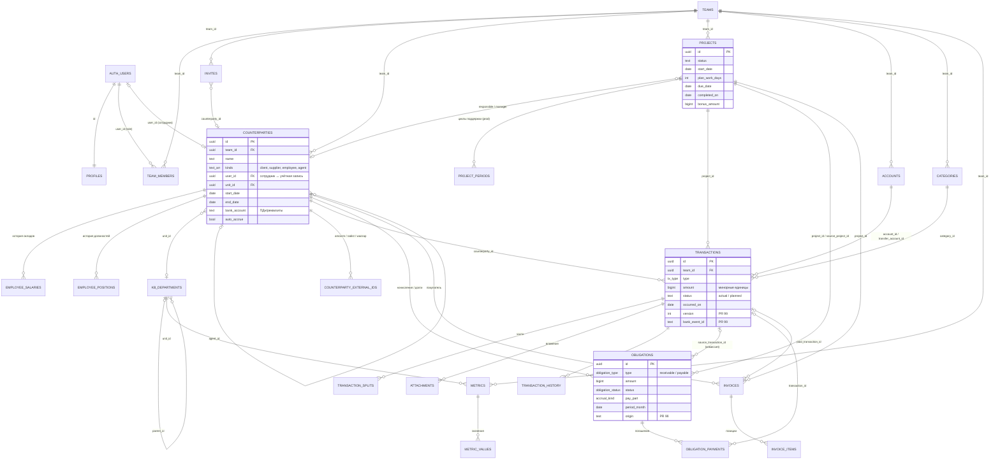
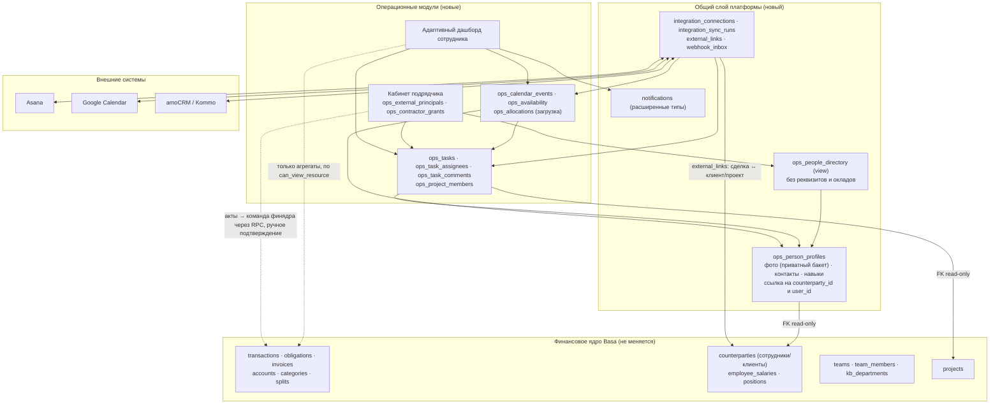

# SYSTEM_ARCHITECTURE.md — Basa Finance → основа для операционной платформы Ko:agency

**Тип документа:** технический аудит (только чтение). Ничего в коде, БД и конфигурации не менялось.
**Дата:** 2026-10-16.
**Ветка репозитория при аудите:** `claude/intelligent-ramanujan-Jdbbu` (PR #99, открыт). База — `main` @ `c5d75d9`.

## 0. Как читать документ

### 0.1. Источники и уровень достоверности

| Метка | Что значит |
|---|---|
| **[код]** | подтверждено чтением файлов репозитория; указан путь |
| **[миграции]** | подтверждено по SQL-миграциям репозитория `finance-app/supabase/migrations/*.sql` (95 файлов) |
| **[prod 23–24.09]** | подтверждено read-only запросами к production-БД 23–24.09.2026 (зафиксировано в `finance-app/DEPLOY_*.md`, `SEC0*_*.md`). **В сессии этого аудита доступа к БД нет** — коннектор Supabase отвечает «нет прав» на проект `basa-finance`, поэтому эти цифры не перепроверены сегодня |
| **[не подтверждено]** | вывод или допущение, которое не проверено ни кодом, ни БД |

### 0.2. Важная оговорка: код в репозитории ≠ код в production

| Слой | Что развёрнуто в production сейчас | Что в репозитории (ветка PR #99) |
|---|---|---|
| Приложение (Vercel) | `main` + патч «maintenance lock» (ветка `maintenance-lock`, `67e9a79`) | + атомарные RPC, оптимистичная блокировка, каноническая идентичность банковских событий, split-aware аналитика |
| БД (Supabase) | миграции до 0084 + 8 миграций, которых нет в репозитории; + ручные hotfix SEC-008/009/010 | + миграции **0086–0092 (в production НЕ применены)**; 0085 тоже не применена |
| Импорт банков | **заморожен с 23.09.2026** (`LOCK_DEFAULT = true`, pg_cron выключен) | то же |

Где в тексте описывается поведение из PR #99, это помечено **(PR #99)**.

### 0.3. Ограничения аудита

- Нет доступа к production-БД в этой сессии → схема описана по миграциям + цифрам [prod 23–24.09].
- **Расхождение истории миграций** [prod 23–24.09]: в production 123 записи в `supabase_migrations.schema_migrations`, в репозитории 95 файлов; ~47 таблиц production создано миграциями, которых нет в репозитории (см. §2.6). Для этих таблиц описание неполное.
- Браузерного/мобильного тестирования не проводилось — выводы об адаптивности получены статически по коду.

---

## 1. Технологическая архитектура

### 1.1. Текущее состояние

**Репозиторий — это не один продукт, а четыре** [код]:

| Каталог | Что это | Стек | Хостинг / деплой |
|---|---|---|---|
| `finance-app/` | **Basa Finance** — финансово-учётная платформа агентства (предмет аудита) | Next.js 14 + Supabase | Vercel, проект `basa-16bf`, домен `basefinance.pro` |
| корень: `widget.js`, `manifest.json`, `css/`, `i18n/`, `images/` | виджет amoCRM «Распределение сделок» (AMD-модуль) | JS | ZIP загружается в amoCRM вручную (`build.sh`) |
| `server/` | бэкенд виджета amoCRM | PHP 8.1+, Slim 4, Guzzle, Monolog, PHP-DI | Docker (`docker-compose.yml`: php-fpm + nginx + certbot), `deploy.sh` → `dist.koagency.me`; GitHub Actions `deploy` только при push в `main` |
| `obsidian-plugin/` | плагин Obsidian «Basa Sync» — двусторонняя синхронизация Базы знаний | JS | вручную (`manifest.json` v0.1.0) |
| `docs/qa-platform.md` | ТЗ на ручное QA Basa | — | — |

**Basa Finance — стек** [код: `finance-app/package.json`]

| Слой | Технология | Версия |
|---|---|---|
| Framework | Next.js (App Router) | `14.2.15` |
| UI runtime | React / React DOM | `^18.3.1` |
| Язык | TypeScript | `^5` (`strict` — см. `tsconfig.json`; алиас `@/* → src/*`) |
| Стили | Tailwind CSS (`darkMode: "class"`) | `^3.4.13` |
| БД / Auth / Storage | Supabase: `@supabase/supabase-js`, `@supabase/ssr` | `^2.45.4`, `^0.5.2` |
| Графики | recharts | `^3.8.1` |
| Анимации | framer-motion | `^12.40.0` |
| Редактор БЗ | TipTap (`starter-kit`, `image`, `link`) | `^2.27.2` |
| Иконки | lucide-react + свои SVG (`src/components/icons.tsx`) | `^1.17.0` |
| Валидация | zod | `^3.25.76` |
| Markdown/HTML | marked, node-html-markdown, sanitize-html | — |
| HTTP | undici (для Точки с российским CA: `src/lib/russianTrustedCa.ts`) | `^8.10.1` |
| Сборка | `next build`; конфиг минимальный (`next.config.js`: только `reactStrictMode`) | — |
| Node на Vercel | `24.x` [prod 23–24.09, Vercel `get_project`] | — |

**Хостинг и окружения**

| Компонент | Значение | Источник |
|---|---|---|
| Vercel | план **Hobby**, проект `basa-16bf`; production + preview на каждую ветку; логи рантайма хранятся **1 час** | [prod 23–24.09], ответ Vercel API |
| Регион функций Vercel | **`iad1` (США, Вашингтон)** | [prod 23–24.09], объект деплоя |
| Supabase | проект `basa-finance`, регион **`eu-central-1`**, PostgreSQL **17.6**, план **Free — без бэкапов и PITR** | [prod 23–24.09] |
| Staging | **отсутствует** (нет отдельного проекта Supabase, нет веток Supabase) | [prod 23–24.09] |
| CI для `finance-app` | **нет**. `.github/workflows/ci.yml` гоняет только PHPUnit виджета и сборку ZIP; PHPUnit падает и на `main`, и на PR #99 | [код], GitHub checks |
| Автотесты `finance-app` | unit/e2e нет; есть SQL-регрессии на одноразовом PostgreSQL: `scripts/concurrency/*.sh` (T1–T14, AUTHZ, SPLIT, SEC-008/010), `scripts/db_integrity_audit.sql` | [код] |
| Переменные окружения, которые читает код | `NEXT_PUBLIC_SUPABASE_URL`, `NEXT_PUBLIC_SUPABASE_ANON_KEY`, `SUPABASE_SERVICE_ROLE_KEY`, `CRON_SECRET`, `TOCHKA_TOKEN_KEY`, `TOCHKA_API_BASE`, `VAULT_KEY`, `RESEND_API_KEY`, `EMAIL_FROM`, `TELEGRAM_BOT_TOKEN`, `NEXT_PUBLIC_SITE_URL`, `FINANCIAL_IMPORTS_DISABLED` (значения в документ не включены) | [код] `grep process.env` |

**Структура `finance-app/src`** [код]

```
src/
├── middleware.ts                 # обновление сессии Supabase + редирект на /login
├── app/
│   ├── (app)/                    # 57 страниц под общим layout (сайдбар, мобильная навигация)
│   ├── api/                      # 33 route handlers
│   ├── auth/ (callback, reset)   # OAuth-callback, сброс пароля
│   ├── login/, join/             # вход, принятие приглашения
│   ├── t/[token]/                # публичное прохождение оценки по токену
│   └── tg/learning/              # Telegram Mini App (обучение)
├── components/                   # 154 компонента (99 в корне, 17 в ui/, остальное по доменам)
└── lib/                          # 44 модуля: доступ к БД, роли, интеграции, расчёты
```

**Архитектурный паттерн доступа к данным** [код, `finance-app/ROLE_PERMISSION_MATRIX.md`]

- **Чтение** — серверные компоненты страниц через `createClient()` из `src/lib/supabase/server.ts` (сессия пользователя, RLS действует).
- **Запись** — в основном **напрямую из браузера в Supabase** (`src/lib/supabase/client.ts`): `.from(...).insert/update/delete` и `.rpc(...)`. Server Actions не используются (`"use server"` — 0 вхождений).
- **API-маршруты** — только там, где нужен секрет или внешний сервис: Точка, инвойсы в банк, приглашения, Telegram, Obsidian, cron, vault.
- **Service role** (`src/lib/supabase/admin.ts`) — только в cron/интеграционных маршрутах.

### 1.2. Ограничения

1. **Нет серверного слоя бизнес-логики.** Для большинства сущностей единственная серверная граница — RLS. Новая логика либо пишется в SQL (RPC / триггеры), либо в браузере.
2. **Нет staging и тестового стенда БД.** Любая миграция идёт сразу в production.
3. **Регионы разнесены:** функции Vercel в США (`iad1`), БД во Франкфурте (`eu-central-1`) — каждый серверный запрос пересекает Атлантику. Влияние на задержку **[не подтверждено замером]**, но архитектурно это лишние ~80–100 мс на круг.
4. **Нет бэкапов** (Free plan) и **нет CI** для основного продукта.
5. Next.js 14.2 — не последняя мажорная версия; обновление до 15 затронет `params`/`searchParams` (в коде уже используется `await params`, что совместимо) **[не подтверждено полной проверкой]**.

### 1.3. Риски

- Отсутствие бэкапов делает любую миграцию для новых модулей необратимой без ручного дампа.
- Hobby-план Vercel: 1 час логов, ограниченные cron (раз в сутки), нет WAF — затрудняет эксплуатацию новых интеграций с вебхуками.

### 1.4. Рекомендации

- До начала Ko:agency: Supabase Pro (PITR), отдельный staging-проект, CI для `finance-app` (`tsc`, `next build`, SQL-регрессии), перенос функций Vercel в `fra1`.
- Новые модули добавлять в тот же Next.js-проект, но в отдельной route group (`app/(ops)/…`) и отдельной папке `src/ops/` — без смешивания с финансовыми компонентами.

---

## 2. База данных

### 2.1. Общие цифры

| Показатель | Репозиторий [миграции] | Production [prod 23–24.09] |
|---|---|---|
| Таблиц в `public` | 63 (`create table`) + 3 представления | **110** таблиц + 3 представления |
| Миграций | 95 файлов (`0001`…`0092`, есть дубли номеров: `0039`, `0050`, `0058`, `0079`) | 123 записи в истории |
| RLS | `enable row level security` — 59 вызовов (часть — циклами) | RLS на **100 %** таблиц `public` (аудит #97) |
| Политик RLS | 171 `create policy` | **194** |
| Индексов | 98 `create index` (16 уникальных) | **194** в `public` |
| Триггеров | 29 | **33** (не внутренних) |
| SECURITY DEFINER функций | ~60 имён (с учётом PR #99) | **48** в `public` (до PR #99) |
| Ограничений (`pg_constraint`, все схемы) | 116 строк с `CHECK` | **585** |
| Объём данных | — | операций ~7 970, контрагентов ~159, счетов 24, обязательств 190, инвойсов 25, пользователей auth — 3 |

**Деньги хранятся в минорных единицах (`bigint`, ×100)**, валюта — код в `currencies` [миграции `0002`, `0012`].

### 2.2. Ядро мультиарендности и людей

| Таблица | Назначение | Ключевые поля | Миграция |
|---|---|---|---|
| `teams` | арендатор (компания) | `base_currency`, реквизиты (`inn`, `kpp`, `ogrn`, `legal_name`, `address`) | `0001`, `0016` |
| `team_members` | членство пользователя в команде + роль | `(team_id, user_id)`, `role app_role` | `0001` |
| `profiles` | профиль пользователя auth | `full_name`, `avatar_url` | `0001` |
| `invites` | приглашения по email | `role`, `status`, `counterparty_id` (привязка к карточке сотрудника) | `0006`, `0071` |
| `counterparties` | **универсальная карточка**: клиент / поставщик / партнёр / **сотрудник** / **агент** | `kind` + `kinds text[]`, `user_id → auth.users`, `unit_id → kb_departments`, даты найма/увольнения, `employment_type`, платёжные реквизиты, `auto_accrue`, `advance_amount`, `contract_*` | `0002`→`0084` |
| `employee_salaries` | история окладов | `counterparty_id`, `effective_from`, `amount`, `currency` | `0023` |
| `employee_positions` | история должностей | `counterparty_id`, `effective_from`, `position` | `0025` |
| `kb_departments` | **оргструктура** (иерархия подразделений) | `parent_id`, `unit_type`, `head_counterparty_id`, `share_percent`, `functions_text` | `0050`, `0054`, `0083` |
| `kb_user_departments` | пользователь ↔ подразделение | `(team_id, user_id, department_id)` | `0051` |
| `team_visibility`, `member_visibility` | видимость разделов по ролям и персонально | `resource`, `allowed_roles` / `visible` | `0069`, `0070` |

**Ключевой факт для Ko:agency:** «сотрудник» в системе — это **строка `counterparties` с `kinds ∋ 'employee'`**, а не пользователь. Связь с учётной записью — опциональная `counterparties.user_id` (уникальна в пределах команды, `0054`). Отдельные таблицы `employees`/`payroll_accruals` были удалены в `0018_unify_employees` [миграции].

### 2.3. Проекты и операционные сущности

| Таблица | Назначение | Ключевые поля |
|---|---|---|
| `projects` | проект/клиентский контракт | `status`, `responsible_counterparty_id`, `manager_counterparty_id`, `start_date`, `plan_work_days`, `due_date`, `completed_on`, `bonus_amount`, `bonus_currency` |
| `project_bonus_tiers` | ступени бонуса за сдачу проекта по просрочке (рабочие дни) | `max_overrun_wd`, `percent` |
| `project_periods` | циклы проектов «поддержки» | **в репозитории нет `create table`** — только в production [prod 23–24.09] |
| `metrics`, `metric_values` | KPI / показатели подразделений и людей | `owner_user_id`, `unit_id`, `period`, `plan` |
| `kb_*`, `academy_*` | база знаний, курсы, тесты, назначения, прогресс | `academy_assignments.recur_months` (переназначение) |
| `assessments`, `assess_*` | оценка компетенций, публичная ссылка | **только production** |
| `vault_entries`, `vault_grants`, `vault_access_log` | хранилище паролей с журналом | шифрование AES-256-GCM на стороне приложения |
| `notifications`, `notification_prefs` | уведомления в приложении | типы: `cash_gap`, `debt_overdue`, `budget_over`, `transfer_short`, `training_due` |

**Задач, календаря загрузки, тайм-трекинга нет** — ни таблиц, ни страниц [миграции, код].

### 2.4. Финансовое ядро

| Таблица | Назначение | Ключевые поля / ограничения |
|---|---|---|
| `accounts` | счета (банк, касса, крипто, «фонды») | `currency`, `opening_balance`, `opening_date`, реквизиты |
| `categories` | статьи доходов/расходов | `kind`, `parent_id`, `cf_activity`, `pnl_treatment` |
| `transactions` | **операции** (доход / расход / перевод), факт и план | `amount > 0`, `type`, `status ('actual'/'planned')`, `account_id`, `transfer_account_id`, `transfer_amount/currency` (кросс-валютный перевод), `category_id`, `counterparty_id`, `project_id`, `obligation_id`, `recurring_rule_id`, `import_batch_id`, `external_id`, `source`; **(PR #99)** `version`, `origin`, `bank_provider*`, сгенерированные `bank_event_id`, `bank_event_fp`, `bank_event_fp_strong` |
| `transaction_splits` | разнесение одной операции на части (проект / контрагент / статья) | сумма частей = сумме операции — **(PR #99)** deferred constraint trigger |
| `transaction_lines` (view) | канонический «управленческий» слой: операция без частей = 1 строка, с частями = N строк | `security_invoker = on` **(PR #99, 0092)** |
| `obligations` | обязательства: дебиторка / кредиторка, **начисления ЗП**, бонусы, комиссии | `type`, `amount`, `status`, `pay_part`, `period_month`, `source_transaction_id`, `source_project_id`, **(PR #99)** `origin` + уникальный индекс авто-начислений |
| `obligation_payments` | погашения обязательств | **(PR #99)** триггер «нет переплаты» |
| `obligation_balances` (view) | остаток по обязательствам | `security_invoker = on` |
| `account_balances` (view) | остатки по счетам | гейт `can_view_resource('balances')` [`0069`] |
| `invoices`, `invoice_items` | счета на оплату клиентам (+ выставление в Точку) | `status`, `tochka_document_id`, `paid_transaction_id`; **(PR #99)** `version`, номер уникален в команде |
| `budgets` | бюджеты по периодам | `period` |
| `recurring_rules` | регулярные операции | материализуются вручную из `RecurringManager.tsx` |
| `agent_commission_rules` | процент агента по статье | триггер на `transactions` |
| `license_*` | реестр лицензий (amoCRM и др.) | `0043`–`0047` |
| `import_batches`, `bank_connections`, `bank_account_links` | импорт выписок и подключение Точки | `bank_connections.token_cipher` — шифротекст |
| `transaction_history` | журнал изменений операций | пишет только триггер |
| `currencies`, `fx_rates` | валюты и курс | **один курс на валюту, без истории** |
| **(PR #99)** `operation_requests`, `invoice_counters`, `bank_reconciliation_conflicts` | идемпотентность команд, счётчик номеров, журнал спорных банковских событий | `0088`, `0090` |

### 2.5. Связи, индексы, ограничения

- **Все бизнес-таблицы несут `team_id → teams(id) on delete cascade`** [миграции]. Это основа изоляции арендаторов и RLS.
- Связи с людьми идут **через `counterparties`**, а не через `auth.users` (кроме авторских полей `created_by` и `counterparties.user_id`).
- Удаление справочников (`accounts`, `categories`, `projects`, `counterparties`) из операций — `on delete set null`; удаление операции каскадно удаляет части, вложения, связанные начисления комиссий (`obligations.source_transaction_id on delete cascade`).
- Перечисления: `app_role`, `tx_type`, `category_kind`, `counterparty_kind (+employee, +agent)`, `obligation_type`, `obligation_status`, `budget_period`, `cf_activity`, `pnl_treatment`, `employment_type`, `accrual_kind`, `kb_*`, `academy_*` [миграции].
- Уникальные индексы, важные для целостности [миграции]: `counterparties (team_id, user_id) where user_id is not null`; **(PR #99)** `invoices_team_number_uniq`, `obligations_auto_accrual_uniq`, `project_periods_project_month_uniq`, `transactions_recurring_slot_uniq`.

### 2.6. Механизмы целостности

| Механизм | Где | Статус |
|---|---|---|
| CHECK `amount > 0` на деньгах | `0002`, `0023`, `0075` | production |
| Журнал изменений операций | триггер `trg_log_transaction_change` → `log_transaction_change` (`0053`) | production |
| Автогашение обязательства операцией | `settle_obligation_on_tx` / `unsettle_obligation_on_tx_delete` (`0035`, `0079`) | production |
| Авто-комиссия агента | `accrue_agent_commission` (`0030`, `0031`) | production |
| Авто-бонус за сдачу проекта | `trg_project_bonus`, `project_set_completed`, `recompute_team_project_bonuses` (`0038`) | production |
| Deferred-проверки сумм (инвойс = Σ позиций, части = операция, нет переплаты) | `0086` | **(PR #99)** |
| Идемпотентные авто-начисления + advisory lock | `0087` | **(PR #99)** |
| Атомарные RPC финансовых команд + idempotency key | `0088`, `0091` | **(PR #99)** |
| Оптимистичная блокировка (`version`) | `0089` | **(PR #99)** |
| Каноническая идентичность банковского события | `0090` | **(PR #99)** |
| Read-only аудит целостности (26 проверок) | `finance-app/scripts/db_integrity_audit.sql` | инструмент |

**Известные дефекты данных** [prod 23–24.09]: 126 двойных учётов переводов (FIN-03), 1 дубликат авто-начисления, «балансировочные» `opening_balance`. Исправление отложено отдельным этапом.

### 2.7. Ограничения

1. **Расхождение истории миграций**: репозиторий не воспроизводит production (нет таблиц `project_periods`, `assessments`, `assess_*`, `bybit_*`, `tochka_sync_log`, `obsidian_connection` и др.; 8 data-миграций есть только в проде). Пересобрать БД с нуля из репозитория невозможно.
2. Сотрудник = контрагент: одна таблица держит и клиентов, и людей, и их платёжные реквизиты.
3. `fx_rates` без истории — аналитика в базовой валюте использует последний курс (FIN-02). Проект перехода зафиксирован в `finance-app/FX_IMPLEMENTATION_DESIGN.md`, не реализован.
4. Нет сущностей задач, времени, загрузки, внешних пользователей.

### 2.8. Риски

- Любая новая миграция без нормализации истории увеличивает расхождение и усложняет восстановление.
- Каскадные удаления по `team_id` — удаление команды стирает все её данные **[не подтверждено, есть ли защита на уровне UI]**.

### 2.9. Рекомендации

- Нормализовать историю: выгрузить фактическую схему production (`pg_dump --schema-only`), зафиксировать её как baseline-миграцию.
- Новые операционные таблицы — только с `team_id` и только **внешними ключами «ops → core»**, никогда «core → ops».

---

## 3. Безопасность

### 3.1. Аутентификация

| Канал | Механизм | Где |
|---|---|---|
| Веб | Supabase Auth: email + пароль; **Google OAuth** (только вход, без доступа к Google API) | `src/app/login/page.tsx:68, :118`; `src/app/auth/callback/route.ts` |
| Сброс пароля | Supabase recovery | `src/app/auth/reset/page.tsx` |
| Приглашение | ссылка → `/join` → RPC `accept_invite` | `src/app/join/page.tsx`, `src/components/AcceptInviteButton.tsx` |
| Сессия | `@supabase/ssr` + `middleware.ts` → `updateSession` | `src/lib/supabase/middleware.ts` |
| Telegram Mini App | HMAC-подпись `initData` | `src/lib/telegram.ts` (`validateInitData`), `src/lib/tg-session.ts` |
| Obsidian | Bearer-токен, в БД хранится хеш | `src/lib/obsidian.ts` (`hashToken`, `teamByToken`) |
| Cron | `Authorization: Bearer CRON_SECRET` | `src/app/api/tochka/cron/route.ts`, `src/app/api/cron/*` |
| Публичная оценка | неугадываемый токен внутри RPC | `src/app/t/[token]/page.tsx`, RPC `assess_public_load/submit` |

Middleware пропускает без сессии: `/login`, `/auth/*`, `/tg`, `/api/tg/*`, `/t/*`, `/api/obsidian/pull|push`, `/api/tochka/cron`, `/api/cron/*` (`src/lib/supabase/middleware.ts`).

**Выбор команды:** `getCurrentTeam()` берёт **первое членство по дате** (`src/lib/team.ts`). Переключателя команд нет — пользователь в двух командах всегда видит первую.

### 3.2. Роли

`app_role = owner | admin | manager | employee | viewer` [миграции `0001`].

| Хелпер | БД (SECURITY DEFINER) | TypeScript (`src/lib/team.ts`) |
|---|---|---|
| участник команды | `is_team_member(team)` | — |
| редактировать финансы | `can_edit_finance(team)` → owner/admin/manager | `canEditFinance` |
| писать операции | `can_write_tx(team)` → + employee | `canWriteTx` |
| управлять командой | `can_manage_team(team)` → owner/admin | `canManageTeam` |
| роль | `current_team_role(team)` | — |
| видимость раздела | `can_view_resource(team, resource)` | `canView` (`src/lib/visibility.ts`) |

После hotfix SEC-008 (23.09) хелперы для не-участника возвращают `false`, а не `NULL` [prod 23–24.09]. Проверки в TypeScript **только скрывают кнопки**; авторизация записи — RLS.

### 3.3. Матрица ролей и прав (фактическая)

Легенда: **R** чтение, **W** создание/изменение/удаление, **own** — только свои, **—** нет доступа. Источник — RLS-политики в миграциях репозитория; production проверен 19.09 (`finance-app/ROLE_PERMISSION_MATRIX.md`).

| Данные | owner | admin | manager | employee | viewer |
|---|:-:|:-:|:-:|:-:|:-:|
| Операции `transactions` | RW | RW | RW | R own, W own | R |
| Части операций `transaction_splits` | RW | RW | RW | **R все** | R |
| Счета, статьи, проекты, бюджеты, курсы | RW | RW | RW | R | R |
| **Контрагенты, включая сотрудников и их реквизиты** | RW | RW | RW | **R все** | **R все** |
| **Оклады `employee_salaries`, должности** | RW | RW | RW | **R все** | **R все** |
| **Обязательства (начисления ЗП, долги)**, погашения | RW | RW | RW | **R все** | **R все** |
| Инвойсы | RW | RW | RW | — | — |
| Остатки `account_balances` | R | R* | R* | R* | R* |
| Банковское подключение (Точка) | RW | RW | RW | — | — |
| Команда, приглашения, видимость | RW | RW | R | R | R |
| Оргструктура, показатели | RW | RW | RW | R | R |
| База знаний, академия | RW | RW | RW | R + прохождение | R + прохождение |
| Пароли (vault) | RW | RW | RW | R по гранту | R по гранту |
| Уведомления | own | own | own | own | own |

\* при условии видимости ресурса `balances` (`team_visibility`/`member_visibility`; по умолчанию — видно).

### 3.4. RLS-политики

Типовые шаблоны [миграции]:

| Шаблон | Кол-во | Пример |
|---|---|---|
| `using (is_team_member(team_id))` на SELECT | ~15+ | справочники, оргструктура, показатели |
| `using/with check (can_edit_finance(team_id))` на запись | ~12+ | справочники, инвойсы, части операций |
| `user_id = auth.uid()` | ~8 | уведомления, профиль |
| Особая логика по роли | — | `transactions_select`: employee видит только `created_by = auth.uid()` (`0002`) |

Справочные таблицы получают политики **циклом** в `0002_finance_core.sql` (`accounts`, `categories`, `counterparties`, `projects`, `budgets`, `fx_rates`).

### 3.5. SECURITY DEFINER-функции

~60 функций [миграции]; основные группы:

| Группа | Функции |
|---|---|
| Хелперы прав | `is_team_member`, `can_edit_finance`, `can_write_tx`, `can_manage_team`, `current_team_role`, `can_view_resource`, `can_modify_tx`, `is_service_role` |
| Финансовые команды **(PR #99)** | `transaction_save`, `transaction_insert`, `transaction_delete`, `transaction_split`, `transactions_bulk_patch`, `transactions_convert_to_transfer`, `transactions_merge_transfer`, `transaction_match_planned`, `invoice_save`, `next_invoice_number`, `obligation_allocate`, `obligation_pay`, `bank_import_commit`, `bank_sync_claim`, `op_begin/op_finish` |
| Начисления | `materialize_auto_accruals`, `materialize_support_cycles`, `support_open_period`, `support_delete_period`, `accrue_agent_commission`, `recompute_*`, `accrue_project_bonus` |
| Триггерные | `log_transaction_change`, `settle_obligation_on_tx`, `trg_bump_version`, `assert_*` |
| Команда / обучение / vault | `create_team`, `accept_invite`, `handle_new_user`, `academy_*`, `kb_*`, `vault_*`, `merge_counterparties` |
| Bybit (только production) | `bybit_sync`, `bybit_fetch`, `bybit_ingest`, `bybit_sync_logged`, `bybit_secrets` — читают ключи из Supabase Vault и ходят во внешний API |

Состояние после hotfix 23.09 [prod 23–24.09]: функций с доступом `anon`/`PUBLIC`, которые пишут финансы, читают Vault или ходят во внешний HTTP, — **0**. Открыт **SEC-011** (MEDIUM): `next_document_number`, `next_project_code` — без закреплённого `search_path`.

### 3.6. Доступ к финансовым данным и внешние пользователи

**Внешних пользователей в модели нет.** Единственный способ дать доступ — `team_members`, после чего человек становится полноправным участником команды и по RLS видит:

- **всех контрагентов команды со всеми платёжными реквизитами** (`counterparties_select = is_team_member`, `0002`): банковские счета, кошельки, телефоны, email сотрудников и клиентов;
- **оклады всех сотрудников** (`employee_salaries`, `0023`) и **все начисления/долги** (`obligations`, `0002`);
- все части операций (`transaction_splits`, `0075`), хотя сами операции для employee ограничены «своими».

Публичные исключения: оценка по токену (`/t/[token]`), Telegram Mini App.

### 3.7. Ограничения и риски

| ID | Риск | Уровень | Основание |
|---|---|---|---|
| ARCH-SEC-01 | **Внутрикомандная конфиденциальность отсутствует**: employee и viewer читают оклады, начисления и платёжные реквизиты всех сотрудников | **HIGH для Ko:agency** (блокирует кабинеты подрядчиков и широкий доступ сотрудников) | [миграции] `0002`, `0023`; в production после 19.09 не перепроверено |
| ARCH-SEC-02 | Части операций видны employee целиком при ограниченном видении самих операций | MEDIUM | [миграции] `0075` |
| ARCH-SEC-03 | **Аватары загружаются в публичный бакет `kb-media`** с путём `{team_id}/avatars/…` | MEDIUM (для «универсальных профилей с фото») | [код] `src/components/profile/ProfileForm.tsx:64-75`; SEC-002 |
| ARCH-SEC-04 | Видимость разделов по умолчанию «разрешено» (PERM-03) | LOW | [код] `src/lib/visibility.ts` |
| ARCH-SEC-05 | `/api/invite`, `/api/assess/invite` без серверной проверки роли (опираются на RLS) | LOW | `ROLE_PERMISSION_MATRIX.md` |
| OPS-01 | `CRON_SECRET` хранится открытым текстом в `cron.job.command` | MEDIUM | [prod 23–24.09] |
| SEC-011 | SECURITY DEFINER без `search_path` | MEDIUM | [prod 23–24.09] |
| ARCH-SEC-06 | RLS — единственная серверная граница записи для большинства таблиц | архитектурный | [код] |

### 3.8. Рекомендации

- **До подключения сотрудников с ролью employee к новым модулям и до любых внешних пользователей** — разделить чтение `counterparties` / `employee_salaries` / `obligations` (например, представления с маскированием реквизитов для не-финансовых ролей, а полный доступ — только `can_edit_finance`). Это изменение RLS финансового ядра → требует отдельного аудита и регрессии AUTHZ.
- Фото профилей — в **приватный** бакет с подписанными URL.
- Внешних подрядчиков **не добавлять в `team_members`** (см. §8.4).

---

## 4. Бизнес-логика

### 4.1. Жизненный цикл сотрудника

```
приглашение (invites, email + роль + counterparty_id)
   → регистрация / вход (handle_new_user создаёт profiles)
   → accept_invite → team_members(role) + привязка counterparties.user_id
   → карточка сотрудника: counterparties(kinds ∋ 'employee'), start_date, employment_type,
     unit_id (подразделение), история должностей и окладов, реквизиты выплат, auto_accrue, advance_amount
   → ежемесячные начисления ЗП (obligations: pay_part='fixed', period_month)
   → выплаты: операции расхода → погашение обязательства (obligation_payments)
   → увольнение: end_date (начисления после даты не создаются — 0059_accrual_respect_end_date)
```

Файлы: `src/app/(app)/employees/*`, `src/components/AddEmployeeForm.tsx`, `SalaryEditor.tsx`, `EditEmployeePayment.tsx`, `src/components/employee/*`, `src/lib/salary.ts` (`salaryForMonth`), `src/lib/workdays.ts`.

### 4.2. Начисления, выплаты, задолженности

| Процесс | Механизм | Где |
|---|---|---|
| Оклад → ежемесячное начисление | `materialize_auto_accruals(team)` для `auto_accrue = true` | `0036`; **(PR #99)** только по кнопке `MaterializeAccrualsButton` → `/api/payroll/materialize`; в production — при открытии `/payroll` |
| Аванс | `counterparties.advance_amount` | `0074` |
| Циклы поддержки (проект с периодами) | `support_open_period`, `materialize_support_cycles`, `project_periods` | prod-миграции, `src/components/SupportPeriods.tsx` |
| Бонус за сдачу проекта | триггер на `projects` при `completed_on`, процент по просрочке в рабочих днях | `0038`, `src/components/ProjectBonusTiers.tsx` |
| Агентская комиссия | триггер на `transactions` по статье и % агента | `0030`, `0031`, `src/components/AgentCommissionRules.tsx`, `AgentPayouts.tsx` |
| Выплата / погашение | операция с `obligation_id` → триггер `settle_obligation_on_tx`; разнесение одной выплаты на несколько обязательств — `obligation_payments` | `0035`, `0079`, `AllocatePaymentButton.tsx`, `PayObligationButton.tsx` |
| Задолженности | `obligation_balances`, страница `/debts` | `src/app/(app)/debts/page.tsx` |
| Плановые операции | `transactions.status = 'planned'` + сверка с фактом | `PlannedReview.tsx`, `transaction_match_planned` |

### 4.3. Проекты

- Проект хранит сроки внедрения (рабочие дни), ответственного и менеджера (через контрагентов), бонус, статус [миграции `0022`, `0038`, `0042`].
- Финансы проекта — операции и части операций с `project_id`; карточка `/projects/[id]` считает выручку/затраты/прибыль через `transaction_lines` (split-aware).
- **Задач, этапов, вех, участников проекта, оценки трудозатрат нет.**

### 4.4. Финансовая аналитика

| Отчёт | Страница |
|---|---|
| Дашборд (остатки, графики, ближайшие платежи) | `src/app/(app)/dashboard/page.tsx`, `src/components/ui/dashboard-widgets.tsx` |
| ДДС (Cash Flow) | `src/app/(app)/reports/cashflow/page.tsx`, `CashflowTable.tsx` |
| P&L | `src/app/(app)/reports/pnl/page.tsx`, `PnlTable.tsx` |
| Анализ расходов | `src/app/(app)/reports/page.tsx` (+ CSV-экспорт) |
| Аналитика команды, академии | `src/app/(app)/reports/team`, `reports/academy` |
| Платёжный календарь | `src/app/(app)/calendar/page.tsx`, `CalendarGrid.tsx` — **это календарь платежей, а не календарь людей** |

Пересчёт в базовую валюту — `src/lib/fx.ts` (`toBase`) по последнему курсу; источник курсов — ЦБ (`src/lib/cbr.ts`).

### 4.5. Автоматические операции и фоновые задачи

| Задача | Где запускается | Расписание | Статус сейчас |
|---|---|---|---|
| Импорт выписки Точки | Vercel Cron → `/api/tochka/cron` | 05:00 UTC | **заблокирован** maintenance lock (503) |
| Авто-синк Точки при открытии приложения | клиент `TochkaAutoSync.tsx` → `/api/tochka/auto-sync` | при входе, ≥ 120 мин | **заблокирован** |
| Дайджест уведомлений | Vercel Cron → `/api/cron/notifications?mode=digest` | 06:00 UTC | работает |
| Переназначение обучения | Vercel Cron → `/api/cron/recurring` (`academy_reissue`) | 07:00 UTC | работает |
| Пересчёт уведомлений | Vercel Cron → `/api/cron/notifications?mode=refresh` | 08:00 UTC | работает |
| Синхронизация Bybit | pg_cron `bybit-sync-daily` → `bybit_sync_logged(7)` | каждые 3 ч | **выключен** с 23.09 |
| Синк Точки через pg_cron | pg_cron `tochka-autosync` → HTTP на `/api/tochka/cron` | каждые 3 ч | **выключен**; и до этого получал 401 из-за устаревшего секрета |
| Триггеры БД | комиссии, бонусы, погашение, журнал операций, `updated_at` | синхронно | работают |

Конфигурация: `finance-app/vercel.json` (cron), pg_cron — только в production. Алерты считаются в `src/lib/alerts.ts` (`computeTeamAlerts`).

### 4.6. Ограничения и риски

- Начисления и бонусы — в триггерах БД. Любая новая таблица, которая пишет в `transactions`/`obligations`, неявно запустит комиссии, погашения и журнал.
- Cron на Hobby — раз в сутки; частых фоновых задач (синк календаря, Asana) на текущем плане не сделать **[не подтверждено лимитами конкретного аккаунта]**.

### 4.7. Рекомендации

- Операционные модули не должны писать в `transactions`/`obligations` напрямую — только через существующие RPC **(PR #99)** и только после явного решения (например, «закрыть месяц подрядчика → создать обязательство»).

---

## 5. Интерфейс

### 5.1. Страницы и маршруты

**61 страница, 33 API-маршрута** [код]. Навигация (`src/components/Sidebar.tsx`, `MobileNav.tsx`):

| Группа | Маршруты |
|---|---|
| Компания | `/os` (ОС компании: оргструктура, показатели, обучение), `/dashboard` |
| Деньги | `/transactions` (+ `/import`, `/sort`, `/categorize`), `/accounts`, `/categories`, `/budgets`, `/recurring`, `/debts`, `/calendar` |
| Клиенты и проекты | `/counterparties`, `/counterparties/[id]`, `/agents`, `/agents/[id]/report`, `/projects`, `/projects/[id]`, `/invoices`, `/licenses` |
| Люди | `/employees`, `/employees/[id]`, `/payroll`, `/team`, `/team/[userId]`, `/profile` |
| Развитие | `/knowledge-base/*`, `/academy/*`, `/assess/*`, `/metrics/*` |
| Отчёты | `/reports`, `/reports/cashflow`, `/reports/pnl`, `/reports/team`, `/reports/academy` |
| Настройки | `/settings` (+ `bank`, `company`, `motivation`, `obsidian`, `rules`, `visibility`), `/vault`, `/notifications` |
| Вне приложения | `/login`, `/join`, `/auth/reset`, `/t/[token]`, `/tg/learning` |

API: `api/tochka/*` (7), `api/invoices/*` (6), `api/tg/*` (6), `api/obsidian/*` (3), `api/vault/*` (3), `api/cron/*` (2), `api/invite`, `api/assess/invite`, `api/cbr`, `api/payroll/materialize` **(PR #99)**, `api/profile/telegram-code`.

### 5.2. Переиспользуемые компоненты

| Компонент | Назначение | Переиспользуемость для Ko:agency |
|---|---|---|
| `Modal.tsx`, `AnchoredPopover.tsx`, `Combobox.tsx`, `ui/select.tsx` | базовые оверлеи и выборы | высокая |
| `CommandPalette.tsx` | быстрый поиск/навигация (⌘K) | высокая, нужно расширение источников |
| `Toaster.tsx`, `src/lib/toast.ts` | уведомления | высокая |
| `EmptyState.tsx`, `ui/pagination.tsx`, `ui/date-range-picker.tsx`, `ui/month-picker.tsx`, `ReportRangePicker.tsx` | состояние, пагинация, периоды | высокая |
| `ui/dashboard-widgets.tsx`, `ui/metric-chart.tsx`, `ui/progress-metric-card.tsx`, `ui/total-income-card.tsx` | виджеты дашборда | средняя (заточены под деньги/метрики) |
| `CalendarGrid.tsx` | месячная сетка | **низкая** — сетка платёжного календаря, не планировщик |
| `profile/ProfileForm.tsx`, `UserRoleCard.tsx`, `MemberRoleControls.tsx` | профиль и роли | средняя (нужна приватная загрузка фото) |
| `org/*` | оргструктура | высокая для профилей и загрузки |
| `NotificationBell.tsx`, `NotificationList.tsx` | уведомления | высокая (нужно расширить `notifications.type`) |
| `OperationsTable.tsx`, `SplitTransactionModal.tsx`, `TransactionPartsEditor.tsx` | финансовые | **не переиспользовать** вне финансов |

### 5.3. Дизайн-система

- **Токены** — CSS-переменные в стиле shadcn (`--background`, `--foreground`, `--card`, `--primary`, `--muted`, `--border`, …) в `src/app/globals.css`, подключены в `tailwind.config.ts`.
- **Цвета бренда:** `brand #2f6df6` (основные действия), `accent #f4500a` (фирменный акцент).
- **Шрифты:** General Sans (латиница/цифры) → Manrope (кириллица) → системный.
- **Классы-примитивы** в `globals.css`: `.btn-primary`, `.btn-ghost`, `.btn-icon`, `.btn-magic`, `.input`, `.surface`, `.modal-backdrop`, `.spinner`, анимации `.animate-*`.
- **Тёмная тема:** `darkMode: "class"`, переключатель `ThemeToggle.tsx`.
- Библиотеки компонентов (shadcn/ui, Radix) **не подключены**: `ui/*` — собственные реализации.

### 5.4. Адаптивность и мобильная версия

- Есть `MobileNav.tsx` и адаптивный layout (`flex-col md:flex-row`).
- По статическому анализу: из 99 корневых компонентов **70 не содержат ни одного адаптивного префикса** (`sm:`/`md:`/`lg:`/`xl:`); горизонтальная прокрутка таблиц (`overflow-x-auto`) — в 17 файлах. PR #96 адаптировал таблицы карточки сотрудника.
- Отсутствие префиксов не означает поломку на мобильном — многие компоненты внутри адаптивных контейнеров **[не подтверждено тестированием на устройствах]**.
- Таблицы операций, P&L и ДДС рассчитаны на десктоп (широкие таблицы со скроллом) **[не подтверждено визуально]**.

### 5.5. Рекомендации

- Вынести примитивы из `globals.css` и `ui/*` в общий пакет компонентов (`src/ui/`) до начала новых модулей; адаптивный дашборд строить на сетке виджетов с явными брейкпоинтами.
- Для календаря загрузки — отдельный компонент планировщика (неделя/день, ресурсная сетка); `CalendarGrid.tsx` не расширять.

---

## 6. Интеграции

### 6.1. Текущее состояние

| Интеграция | Направление | Механизм | Где | Статус |
|---|---|---|---|---|
| **Банк «Точка»** | pull выписок; push счетов на оплату; статус оплаты | REST, токен клиента шифруется (`TOCHKA_TOKEN_KEY`) | `src/lib/tochka.ts`, `src/lib/tochka-import.ts`, `api/tochka/*`, `api/invoices/[id]/issue`, `…/tochka-status` | импорт **заморожен** |
| **Bybit** | pull выводов/депозитов USDT | PostgreSQL-расширение `http`, ключи в Supabase Vault, pg_cron | только production-функции `bybit_*` | **выключен** |
| **ЦБ РФ** | курсы валют | `cbr-xml-daily.ru` | `src/lib/cbr.ts`, `api/cbr` | работает |
| **Telegram** | Mini App обучения + привязка аккаунта кодом | HMAC `initData`, одноразовый код | `src/lib/telegram.ts`, `api/tg/*`, `api/profile/telegram-code` | работает |
| **Email (Resend)** | дайджест уведомлений | REST | `src/lib/email.ts` | **[не подтверждено]**, что ключ задан в production |
| **Obsidian** | двусторонняя синхронизация Базы знаний | Bearer-токен (хеш в БД) | `src/lib/obsidian.ts`, `api/obsidian/*`, `obsidian-plugin/` | работает |
| **Google** | **только вход (OAuth)** | Supabase Auth | `src/app/login/page.tsx:118` | работает; доступа к Google Calendar API нет |
| **amoCRM / Kommo** | (1) внешние ID клиента для автопривязки платежей; (2) отдельный сервис распределения сделок | (1) таблица `counterparty_external_ids (system ∈ amocrm/radist/wazzap)`; (2) PHP-сервис, OAuth-токены в **JSON-файлах на диске** | (1) `0058_counterparty_external_ids.sql`, `EditCounterpartyForm.tsx`, `CategorizeWizard.tsx`; (2) `server/src/AmoCRM/ApiClient.php`, `server/src/Http/Controller/WebhookController.php` | (1) работает; (2) **[не подтверждено]**, что сервис запущен на `dist.koagency.me` |
| **Asana** | — | — | — | **нет** |
| **Google Calendar** | — | — | — | **нет** |

### 6.2. Webhooks

- **Входящих вебхуков в `finance-app` нет.** Есть только эндпоинты, авторизуемые секретом: cron (`CRON_SECRET`), Obsidian (Bearer).
- PHP-сервис принимает вебхук amoCRM `POST /webhook/leads` (события `leads[add]`, `leads[status]`); проверка — опциональный заголовок `X-Widget-Secret` (если `WIDGET_SECRET` не задан — проверки нет) (`server/src/Http/Controller/WebhookController.php`). `AuthMiddleware` в PHP-сервисе — заглушка и не подключена.

### 6.3. Механизмы синхронизации

- **Точка:** окно 10 дней (авто-синк) / 45 дней (cron); дедуп по `external_id` (сейчас) и по `bank_event_id` с журналом конфликтов **(PR #99)**; захват права на синк атомарным CAS `bank_sync_claim` **(PR #99)**.
- **Bybit:** окно 7 дней, дедуп по `external_id`.
- **Obsidian:** pull/push с конвертацией HTML↔Markdown.
- Общего механизма (очередь, журнал синков, повторные попытки) **нет** — у каждой интеграции свой; `tochka_sync_log` в production пуст [prod 23–24.09].

### 6.4. Ограничения и риски

- Секреты интеграций хранятся по-разному: env Vercel (Точка-ключ шифрования, Telegram, Resend), Supabase Vault (Bybit), открытым текстом в `cron.job` (OPS-01), JSON-файлы на диске (amoCRM).
- Google OAuth запрашивает только вход; для Google Calendar потребуются новые scopes, экран согласия и хранение refresh-токенов на пользователя.

### 6.5. Рекомендации

- Единый **слой интеграций**: таблицы `integration_connections` (зашифрованные токены по образцу `bank_connections` + `src/lib/crypto.ts`), `integration_sync_runs` (журнал), `external_links` (обобщение `counterparty_external_ids`: любая сущность ↔ внешний объект), и единый обработчик входящих вебхуков с проверкой подписи и идемпотентностью (по образцу `operation_requests`).
- amoCRM: перенести OAuth-токены PHP-сервиса из файлов в зашифрованное хранилище и подключать сделки к `counterparties`/`projects` через `external_links`.

---

## 7. Схема архитектуры (Mermaid)



---

## 8. ER-диаграмма основных сущностей

Показаны сущности, важные для Ko:agency. Поля — сокращённо.



---

## 9. Матрица ролей и прав доступа (сводная, с учётом будущих модулей)

### 9.1. Текущие роли — по доменам

| Домен | owner | admin | manager | employee | viewer |
|---|:-:|:-:|:-:|:-:|:-:|
| Управление командой и ролями | ✅ | ✅ | ❌ | ❌ | ❌ |
| Финансы — изменение | ✅ | ✅ | ✅ | ⚠️ только свои операции | ❌ |
| Финансы — чтение операций | ✅ | ✅ | ✅ | только свои | ✅ все |
| Справочники, проекты — чтение | ✅ | ✅ | ✅ | ✅ | ✅ |
| **Зарплаты, начисления, реквизиты коллег — чтение** | ✅ | ✅ | ✅ | ⚠️ **✅ (нежелательно)** | ⚠️ **✅ (нежелательно)** |
| Инвойсы, банковское подключение | ✅ | ✅ | ✅ | ❌ | ❌ |
| Оргструктура, показатели — изменение | ✅ | ✅ | ✅ | ❌ | ❌ |
| Обучение — прохождение | ✅ | ✅ | ✅ | ✅ | ✅ |
| Vault — раскрытие | по гранту / финансовые роли | | | по гранту | по гранту |

⚠️ — фактическое поведение по RLS, расходящееся с ожиданиями (`ROLE_DESCRIPTIONS.employee` в `src/lib/types.ts` обещает «финансы скрыты»).

### 9.2. Целевые роли для Ko:agency (предложение, не реализовано)

| Возможность | owner | admin | manager | employee | viewer | **contractor (новый, вне team_members)** |
|---|:-:|:-:|:-:|:-:|:-:|:-:|
| Свой профиль и фото | W | W | W | W | W | W (только свой) |
| Профили коллег (без финансов) | R | R | R | R | R | ❌ (только контакты своего менеджера проекта) |
| Проекты — список | R/W | R/W | R/W | R (участник) | R | R (только назначенные) |
| Задачи | R/W | R/W | R/W | R/W (свои и проекта) | R | R/W (только свои в назначенных проектах) |
| Календарь / загрузка — свой | R/W | R/W | R/W | R/W | R | R/W |
| Календарь / загрузка — команды | R/W | R/W | R/W | R (занятость без деталей) | R | ❌ |
| Акты / начисления подрядчику | R/W | R/W | R/W | ❌ | ❌ | R (только свои, через представление) |
| Финансовое ядро | как сейчас | | | | | **❌ никогда напрямую** |

---

## 10. Критичные компоненты — не менять без отдельного аудита

| # | Компонент | Почему критичен | Где |
|---|---|---|---|
| 1 | RLS-политики финансовых таблиц и хелперы `is_team_member`, `can_edit_finance`, `can_write_tx`, `can_manage_team`, `current_team_role` | единственная серверная граница записи; используются в 110+ политиках | `0001`, `0002`, hotfix SEC-008 |
| 2 | SECURITY DEFINER RPC финансовых команд **(PR #99)** и `bank_import_commit` | атомарность денег, идемпотентность, авторизация внутри | `0088`–`0091` |
| 3 | Триггеры `settle_obligation_on_tx`, `accrue_agent_commission`, `trg_project_bonus`, `log_transaction_change`, `assert_*` | неявно создают/гасят обязательства и журнал при любой записи в `transactions` | `0030`, `0035`, `0038`, `0053`, `0079`, `0086` |
| 4 | `materialize_auto_accruals`, `materialize_support_cycles` | начисление зарплаты; в прошлом давали двойное начисление | `0036`, `0087` |
| 5 | Представления `transaction_lines`, `account_balances`, `obligation_balances` | на них стоит вся аналитика и гейт остатков | `0069`, `0092` |
| 6 | `src/lib/tochka-import.ts`, `src/lib/tochka.ts`, `api/tochka/*`, `src/lib/maintenance.ts` | импорт банковских операций, идентичность событий, замок | — |
| 7 | Функции Bybit и pg_cron | читают Vault, ходят во внешний API, пишут в `transactions` | только production |
| 8 | `src/lib/supabase/middleware.ts` (список исключений) | открытие любого пути без сессии | — |
| 9 | `src/lib/crypto.ts`, `src/lib/vault-crypto.ts` | шифрование токенов банка и паролей | — |
| 10 | Схема `counterparties` (поле `user_id`, `kinds`, реквизиты) | сотрудники, клиенты, агенты и платёжные данные в одной таблице | `0018`, `0032`, `0054` |
| 11 | `fx` / `cbr` и всё, что пересчитывает в базовую валюту | готовится отдельный FX-проект | `src/lib/fx.ts`, `FX_IMPLEMENTATION_DESIGN.md` |
| 12 | История миграций (`supabase_migrations.schema_migrations`) | расходится с репозиторием | — |

---

## 11. Оценка расширяемости

### 11.1. Можно переиспользовать

| Что | Как |
|---|---|
| Мультиарендность (`teams`, `team_members`, `team_id` + RLS-шаблоны) | все новые таблицы — с `team_id` и теми же хелперами |
| Оргструктура `kb_departments` + `counterparties.unit_id` | основа профилей и загрузки по подразделениям |
| История должностей и окладов | профиль сотрудника (должности — да; оклады — только для финансовых ролей) |
| `projects` | корень модуля проектов; задачи будут ссылаться на `project_id` |
| `metrics` / `metric_values` | KPI в адаптивном дашборде |
| Уведомления (`notifications`, `NotificationBell`) | события задач и календаря (нужно расширить CHECK `type`) |
| Видимость разделов (`team_visibility`, `can_view_resource`) | скрытие новых модулей по ролям |
| `counterparty_external_ids` | прототип связей с amoCRM/Asana |
| Шаблон зашифрованного подключения (`bank_connections` + `crypto.ts`) | хранение OAuth-токенов Google/Asana/amoCRM |
| Идемпотентность (`operation_requests`, `op_begin/op_finish`) **(PR #99)** | входящие вебхуки |
| UI-примитивы, тема, `CommandPalette`, `Modal`, `Toaster` | общий каркас |
| Telegram-привязка | уведомления о задачах в Telegram |

### 11.2. Создавать с нуля

- Задачи (иерархия, статусы, исполнители, сроки, комментарии, вложения).
- Планирование загрузки (рабочие часы, отпуска, назначения на проекты, ёмкость).
- Календарь событий людей (не платёжный).
- Внешний контур подрядчиков: учётные записи, приглашения, отдельные политики и представления.
- Слой интеграций (подключения, синки, вебхуки, журнал).
- Приватное хранение фото профиля.
- Staging-окружение, CI, бэкапы.

### 11.3. Потенциально опасные изменения

| Изменение | Почему опасно |
|---|---|
| Добавить подрядчиков в `team_members` с любой существующей ролью | откроет им реквизиты, оклады и долги всей команды (ARCH-SEC-01) |
| Писать из новых модулей в `transactions` / `obligations` | сработают триггеры комиссий, погашений, бонусов, журнала |
| Менять `counterparties` (переименование, перенос сотрудников в новую таблицу) | на ней держатся операции, обязательства, начисления, агенты, инвойсы |
| Менять RLS-хелперы ради новых ролей | затронет 190+ политик финансового ядра |
| Расширять `app_role` новым значением | все `current_team_role(...) in (...)` и `canEditFinance` в TS нужно перепроверить; новое значение по умолчанию попадёт в «участник команды» |
| Использовать `getCurrentTeam()` для многокомандных пользователей (подрядчик в нескольких агентствах) | берёт первую команду |
| Загружать новые файлы в `kb-media` | бакет публичный |
| Делать миграции без нормализации истории и без бэкапа | необратимо |

### 11.4. Как изолировать новые операционные модули от финансового ядра

1. **Односторонние зависимости.** Новые таблицы `ops_*` ссылаются на `teams`, `projects`, `counterparties` (только чтение по FK). Таблицы ядра **никогда** не получают FK на `ops_*`.
2. **Без записи в финансовые таблицы.** Если операционное событие должно стать деньгами (закрытый месяц подрядчика, акт), — явная команда через существующий RPC финансового ядра с ролью `can_edit_finance`, отдельная кнопка и журнал.
3. **Свои RLS-хелперы.** `ops_is_project_member(project)`, `ops_can_manage_project(project)`, `ops_is_contractor_for(project)` — новые функции, не меняющие существующие.
4. **Свой код.** `src/app/(ops)/…`, `src/ops/lib/…`, `src/ops/components/…`; финансовые компоненты не импортируются.
5. **Свои представления для пересечений.** Например, `ops_people_directory` — профиль без реквизитов и окладов; подрядчики читают только его.
6. **Отдельная схема БД** (`ops`) — возможна, но потребует добавить её в exposed schemas PostgREST; на текущем этапе проще префикс `ops_` в `public` **[решение за архитектором]**.

---

## 12. Предлагаемая архитектура модулей Ko:agency



| Модуль | Основные сущности | Опора на существующее |
|---|---|---|
| Профили | `ops_person_profiles` (1:1 с сотрудником-контрагентом или внешним исполнителем), фото в приватном бакете `avatars`, signed URL | `profiles`, `counterparties.user_id`, `kb_departments`, `employee_positions` |
| Дашборд | конфигурация виджетов на пользователя, агрегаты задач/загрузки/KPI | `metrics`, `notifications`, `can_view_resource` |
| Проекты и задачи | `ops_project_members`, `ops_tasks` (иерархия, статус, срок, оценка), комментарии, вложения | `projects`, `teams` |
| Календарь и загрузка | события, рабочие часы, отсутствия, аллокации человек ↔ проект на период | `src/lib/workdays.ts` (рабочие дни) |
| Кабинет подрядчика | отдельная учётная запись Supabase Auth **без** `team_members`; гранты на проекты; доступ только через представления | — (новый контур) |
| Интеграции | подключения, синки, внешние связи, входящие вебхуки | `bank_connections` + `crypto.ts`, `counterparty_external_ids`, `operation_requests` |
| Связь с финансами | «закрыть период подрядчика» → обязательство через RPC финядра; себестоимость проекта = аллокации × ставка (аналитика, только чтение) | `obligations`, `obligation_allocate`, `transaction_lines` |

---

## 13. План поэтапного внедрения

| Этап | Содержание | Критерий готовности | Зависимости |
|---|---|---|---|
| **0. Фундамент** | Довести запуск PR #99 (миграции 0086–0092, снятие замка); Supabase Pro + PITR; staging-проект; CI для `finance-app` (`tsc`, build, SQL-регрессии); нормализация истории миграций; перенос функций Vercel в `fra1`; закрыть SEC-011, OPS-01 | production = репозиторий; есть бэкап и staging; CI зелёный | — |
| **1. Конфиденциальность ядра** | Решение по ARCH-SEC-01/02: маскирование реквизитов и окладов для не-финансовых ролей; приватный бакет для фото; `ensureVisible('finance')` | AUTHZ-регрессия расширена кейсами employee/viewer; утечек реквизитов нет | этап 0 |
| **2. Профили и дашборд** | `ops_person_profiles`, `ops_people_directory`, загрузка/замена фото, адаптивный дашборд с виджетами (задачи — заглушки) | профиль редактируется с телефона; фото не доступно без подписи | этап 1 |
| **3. Проекты и задачи** | участники проекта, задачи, комментарии, уведомления | основной сценарий «создать — назначить — закрыть» на десктопе и мобильном | этап 2 |
| **4. Календарь и загрузка** | рабочие часы, отсутствия, аллокации, обзор загрузки команды | видна перегрузка/недогрузка по неделям | этап 3 |
| **5. Google Calendar и Asana** | слой интеграций; OAuth на пользователя (Google) и на команду (Asana); двусторонний синк с журналом | повторный синк не создаёт дублей; ошибки видны в журнале | этапы 3–4 |
| **6. Кабинеты подрядчиков** | внешние учётные записи, гранты, представления, свой layout | подрядчик видит только свои задачи/проекты/акты; пентест AUTHZ | этапы 1, 3 |
| **7. amoCRM / Kommo** | сделки ↔ клиенты/проекты через `external_links`; перенос токенов PHP-сервиса в шифрованное хранилище; решение о судьбе PHP-сервиса | сделка автоматически связана с клиентом и проектом | этап 5 |
| **8. Связь с финансами** | себестоимость проекта по загрузке (только чтение); закрытие периода подрядчика → обязательство через RPC финядра | суммы сходятся с ручным расчётом; финансовые показатели не меняются без явной команды | этапы 4, 6 |

Принцип для всех этапов: каждый этап — отдельная миграция с откатом, прогон на staging, AUTHZ-регрессия и сверка финансового baseline до и после.

---

## 14. Сводка рисков для старта Ko:agency

| Приоритет | Что | Действие |
|---|---|---|
| 1 | Нет бэкапов и staging | этап 0 |
| 2 | Сотрудники и viewer видят оклады, начисления и реквизиты всех коллег | этап 1, до расширения доступа |
| 3 | Внешних пользователей в модели нет; добавление в `team_members` = полный доступ к ядру | отдельный контур (этап 6) |
| 4 | Аватары в публичном бакете | этап 1 |
| 5 | Production ≠ репозиторий (PR #99 не запущен, история миграций расходится) | этап 0 |
| 6 | Нет общего слоя интеграций и вебхуков | этап 5 |
| 7 | Hobby-план Vercel (1 ч логов, cron раз в сутки) и разнесённые регионы | этап 0 |
